# HolaTui - Welcome message on the command line and in the text menu


[-purple.svg)](https://github.com/cloudgen/ciao)
[](https://github.com/cloudgen/HolaTui)
-orange?style=flat-square)

HolaTui prints a welcome message. The typed verb `hello` prints that line in the terminal. Menu row **1 hello** shows the same line on the text menu.

On a terminal, starting it with no arguments opens a text menu. The menu shows the welcome line when you choose row 1. It does not call cargo until you choose a lifecycle row or type a lifecycle verb.

## Features

- Text menu on a terminal: **hello**, **system-log**, **self-management**, **language**, and **Exit**
- The first row shows the current folder and a local clock (`HH:MM:SS`) when the row has room
- Numbered rows line up in display columns. A rounded input box sits along the bottom, as wide as the terminal, with the name and version on the status line under the box
- **hello** (1) shows a welcome message on the menu. The typed verb `hello` prints that message in the terminal and does not draw the menu
- **system-log** (3) opens view-log, clear-log, and log-folder. **self-management** (6) opens version, about, and the cargo lifecycle rows. **language** (7) picks the menu language
- Console program `hola-tui`
- Typed verbs: `help`, `version`, `about`, `hello`, `self-install`, `version-check`, `self-update`, `self-uninstall`

## Advantages

1. **Two ways to see the welcome.** `hola-tui hello` prints one line in the terminal and does not draw the menu. On the menu, row **1 hello** shows that same line. With no arguments on a terminal, the text menu opens and waits. With no terminal and no verb, the program prints help and returns 0.
2. **Built-in languages.** Row **7** lists thirteen languages: English, Simplified Chinese, Traditional Chinese, Spanish, Arabic, French, Portuguese, Russian, German, Japanese, Korean, Dutch, and Greek. The choice is saved for the next run. The welcome line stays English.
3. **Lifecycle and diagnostics.** `version-check`, `self-update`, `self-install`, and `self-uninstall` are menu rows **64**–**67** and typed verbs. `self-uninstall` on the command line needs `--force`. Choosing that row on the menu is the confirmation. They call cargo and do not use root. **system-log** (**3**) views a log, clears a log, and shows the log folder. **about** (**63**) stays in English.

## Quick Installation

**Build tools:** `rustc` 1.74 or newer and `cargo` on `PATH`. No media tool is required. No Python package is required.

### From this checkout

```bash
git clone https://github.com/cloudgen/HolaTui.git
cd HolaTui
cargo install --path .
```

This installs the binary **`hola-tui`**. Crate name is `holatui`. This tree is **1.0.0**.

### From the cargo registry

When the crate is published:

```bash
cargo install holatui
```

### Main menu

After install, on a terminal, `hola-tui` with no arguments prints this screen. The verb is bold and the note after the colon is italic. `9` leaves. `0` on a submenu goes back. After a command finishes, the main menu is shown again. A number that is not on the list prints an error and lets you choose again.

Picture of the English menu. Current directory `/tmp/clips`. The rows are the text the menu paints. The frame is the 80-column box.

```text
$ hola-tui
Path: /tmp/clips                                                       12:06:45

1. **hello**          : *show a welcome message*
3. **system-log**     : *view, clear, and the log folder*
6. **self-management**: *version, about, and cargo lifecycle*
7. **language**       : *display language for this menu*
9. **Exit**           : *leave*

╭─────────────────────────────────────────────────────────────────────────────╮
│ >                                                                           │
╰─────────────────────────────────────────────────────────────────────────────╯
  HolaTui 1.0.0  │  main menu  │  Up/Down  •  Enter
```

**system-log** (3):

```text
Path: /tmp/clips                                                       12:06:45

31. **view-log**  : *list a log file and show it*
32. **clear-log** : *empty one log file*
33. **log-folder**: *show the log folder*
 0. **Back**      : *return to the main menu*

╭─────────────────────────────────────────────────────────────────────────────╮
│ >                                                                           │
╰─────────────────────────────────────────────────────────────────────────────╯
  HolaTui 1.0.0  │  system-log  │  Up/Down  •  Enter
```

**language** (7). The short on each language row is that language’s own name. Numbers 70 and 84–89 are not printed. `0` goes back and does not save.

```text
Path: /tmp/clips                                                       12:06:46

71. **English**   : *use English for this menu*
72. **简体中文**      : *use 简体中文 for this menu*
73. **繁體中文**      : *use 繁體中文 for this menu*
74. **Español**   : *use Español for this menu*
75. **العربية**   : *use العربية for this menu*
76. **Français**  : *use Français for this menu*
77. **Português** : *use Português for this menu*
78. **Русский**   : *use Русский for this menu*
79. **Deutsch**   : *use Deutsch for this menu*
80. **日本語**       : *use 日本語 for this menu*
81. **한국어**       : *use 한국어 for this menu*
82. **Nederlands**: *use Nederlands for this menu*
83. **Ελληνικά**  : *use Ελληνικά for this menu*
 0. **Back**      : *return to the main menu*

╭─────────────────────────────────────────────────────────────────────────────╮
│ >                                                                           │
╰─────────────────────────────────────────────────────────────────────────────╯
  HolaTui 1.0.0  │  language  │  Up/Down  •  Enter
```

**self-management** (6):

```text
Path: /tmp/clips                                                       14:05:09

62. **version**       : *show the installed version*
63. **about**         : *version and this computer*
64. **version-check** : *compare this install with cargo*
65. **self-update**   : *upgrade this package with cargo*
66. **self-uninstall**: *remove this package with cargo*
67. **self-install**  : *install this package with cargo*
 0. **Back**          : *return to the main menu*

╭─────────────────────────────────────────────────────────────────────────────╮
│ >                                                                           │
╰─────────────────────────────────────────────────────────────────────────────╯
  HolaTui 1.0.0  │  self-management  │  Up/Down  •  Enter
```

Choose a number, or type the command name in the box. The block caret appears in that box while it is focused.

## Usage

```bash
hola-tui
```

On a terminal, that opens the main menu above. With no terminal, the same command prints help and returns 0.

**hello** (1) stays on the menu and shows `Welcome to HolaTui 1.0.0.` Any key returns to the main menu. The typed verb prints that same line in the terminal and does not draw the menu:

```bash
hola-tui hello
```

```bash
hola-tui help
hola-tui version
hola-tui about
hola-tui hello
hola-tui version-check
hola-tui self-update
hola-tui self-install
hola-tui self-uninstall --force
```

`version` prints `HolaTui 1.0.0` and does not call cargo. `about` shows one English page: the product identity, a host check of this computer, and a star box. `hello` prints `Welcome to HolaTui 1.0.0.` and does not draw the menu. `help` prints usage.

`version-check` runs `cargo search holatui --limit 1`. `self-update` runs `cargo install holatui --force`. `self-install` runs `cargo install holatui`. `self-uninstall` runs `cargo uninstall holatui` and needs `--force` on the command line. Those cargo verbs do not use sudo. Empty arguments do not install or update.

Exit codes: 1 for an unknown verb, a bad option, or a menu that cannot open. A cargo lifecycle verb returns cargo’s status. Menu **Exit** (9) returns 0. Ctrl-C on the text screen returns 130. `hello` returns 0.

## Screenshots

These pictures are captures of HolaTui **1.0.0**. The path line is `/tmp/clips`. Row **1** is **hello**.

### `main-menu-en.png`

English front board. **1 hello** is highlighted. The path label is `Path`.

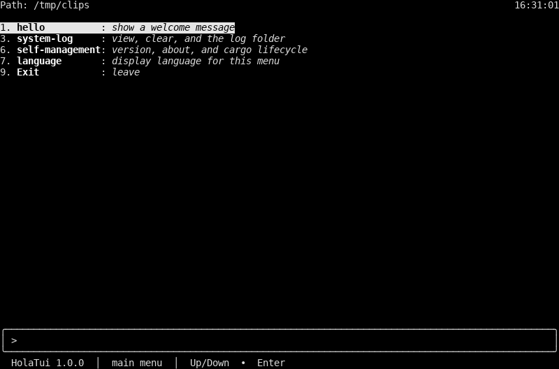

### `main-menu-zh-hans.png`

Simplified Chinese front board. **1 hello** is highlighted. The path label is `路径`.

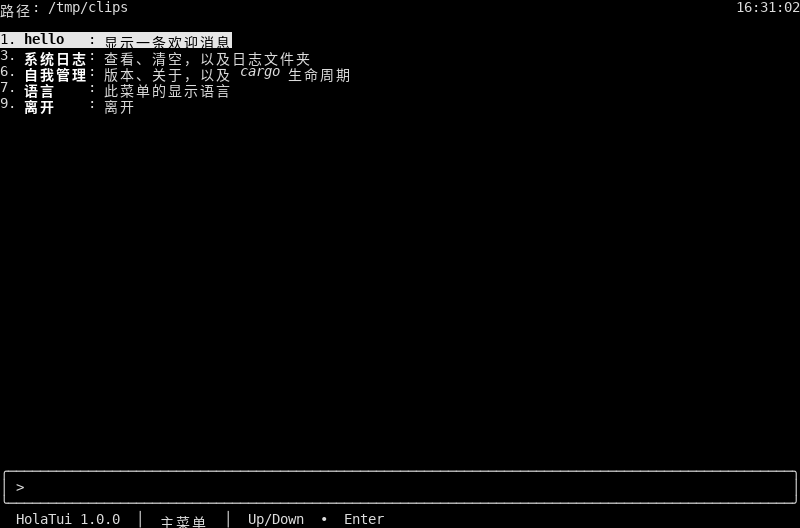

### `main-menu-zh-hant.png`

Traditional Chinese front board. **1 hello** is highlighted. The path label is `路徑`.

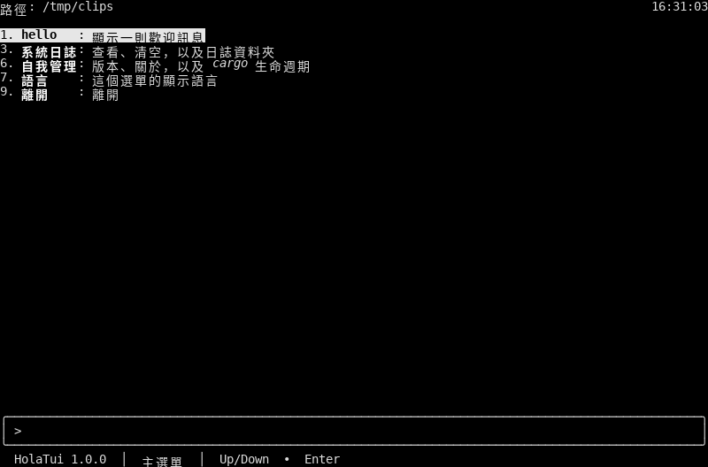

### `main-menu-es.png`

Spanish front board. **1 hello** is highlighted. The path label is `Ruta`.

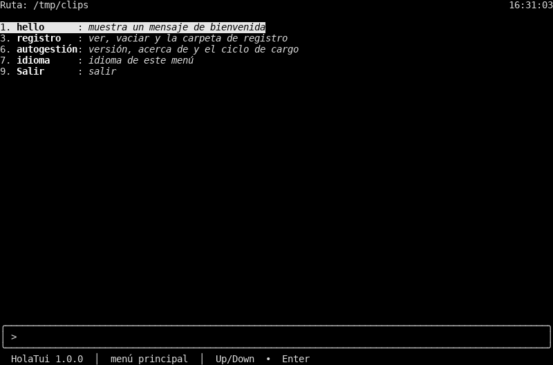

### `main-menu-ar.png`

Arabic front board. **1 hello** is highlighted. The path label is `المسار`.

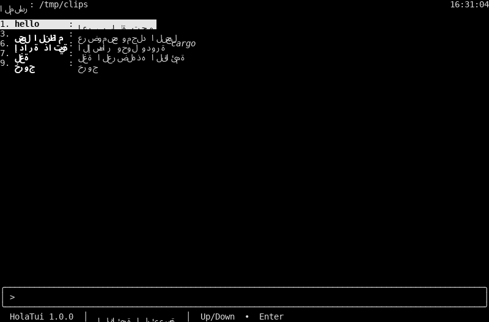

### `main-menu-fr.png`

French front board. **1 hello** is highlighted. The path label is `Chemin`.

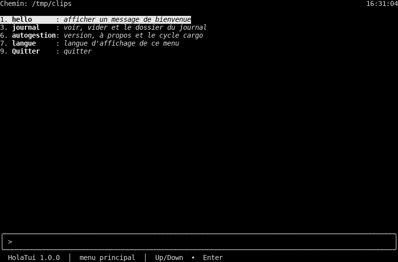

### `main-menu-pt.png`

Portuguese front board. **1 hello** is highlighted. The path label is `Caminho`.

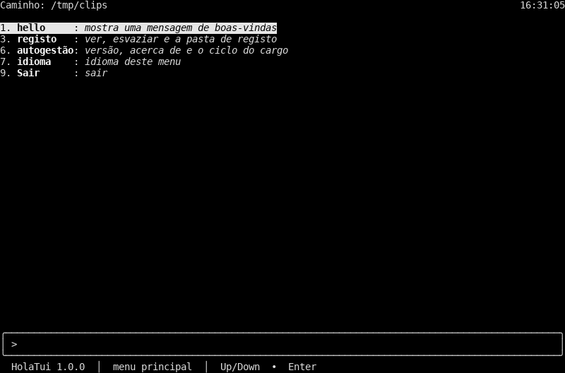

### `main-menu-ru.png`

Russian front board. **1 hello** is highlighted. The path label is `Путь`.

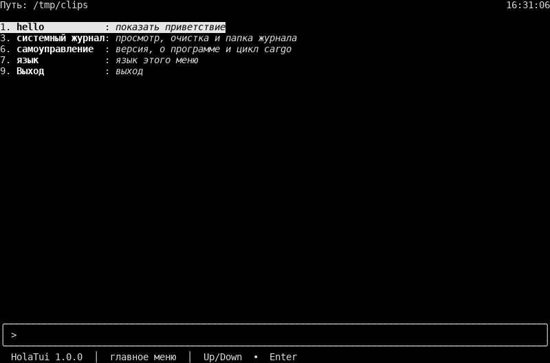

### `main-menu-de.png`

German front board. **1 hello** is highlighted. The path label is `Pfad`.

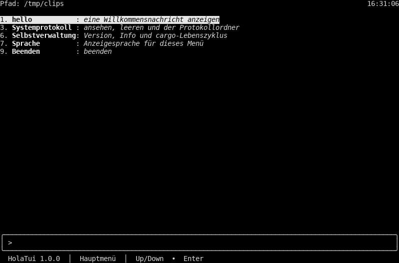

### `main-menu-ja.png`

Japanese front board. **1 hello** is highlighted. The path label is `パス`.

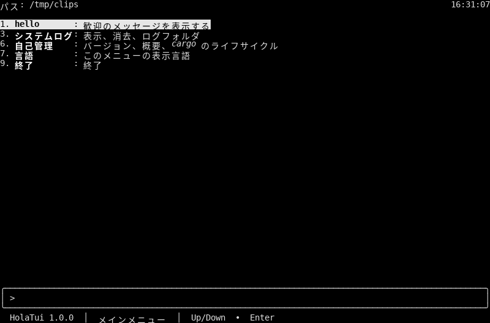

### `main-menu-ko.png`

Korean front board. **1 hello** is highlighted. The path label is `경로`.

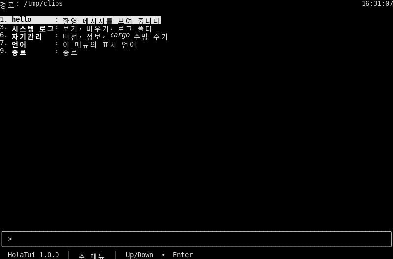

### `main-menu-nl.png`

Dutch front board. **1 hello** is highlighted. The path label is `Pad`.

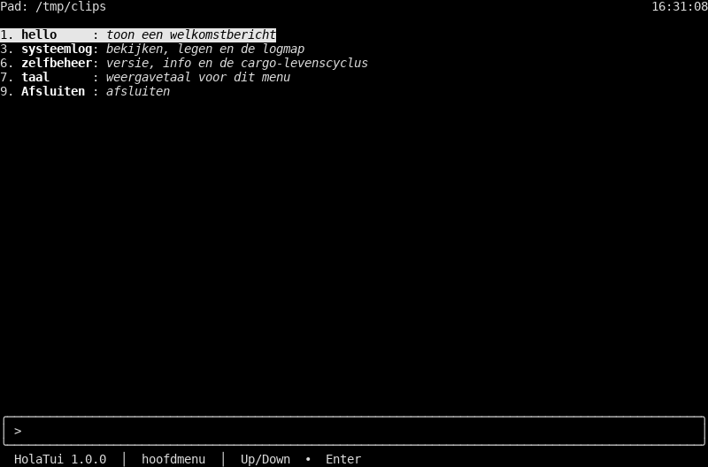

### `main-menu-el.png`

Greek front board. **1 hello** is highlighted. The path label is `Διαδρομή`.

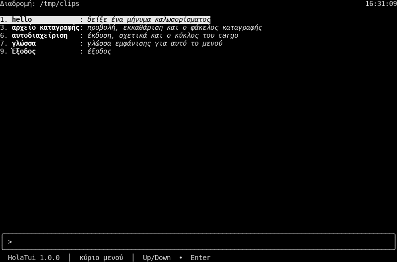

### `language-menu.png`

Language board. **71 English** is highlighted. Rows **71**–**83** are the thirteen languages. **0** goes back.

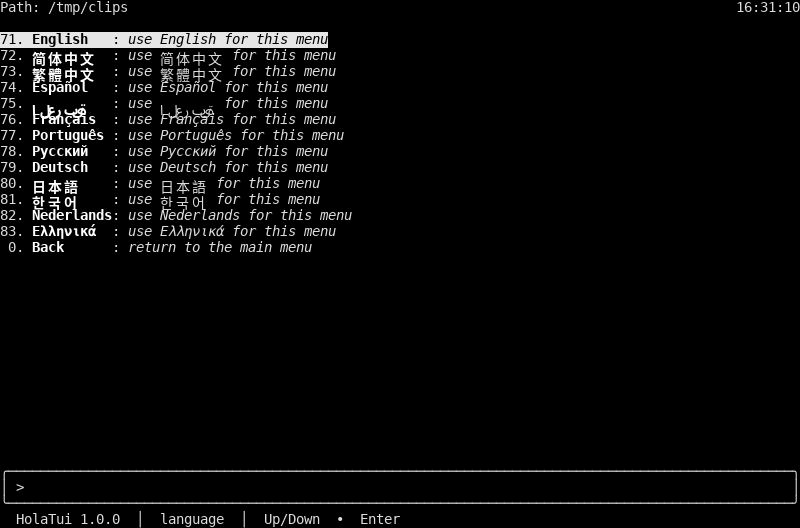

### `self-management.png`

Self-management board. **62 version** is highlighted. The notes name cargo.

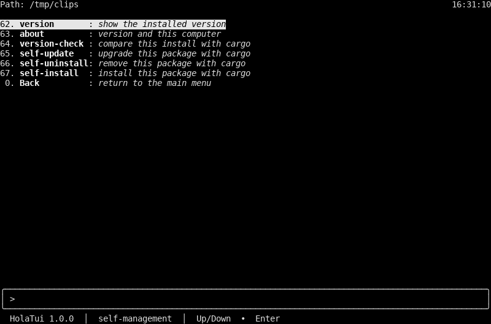

### `system-log.png`

System-log board. **31 view-log** is highlighted.

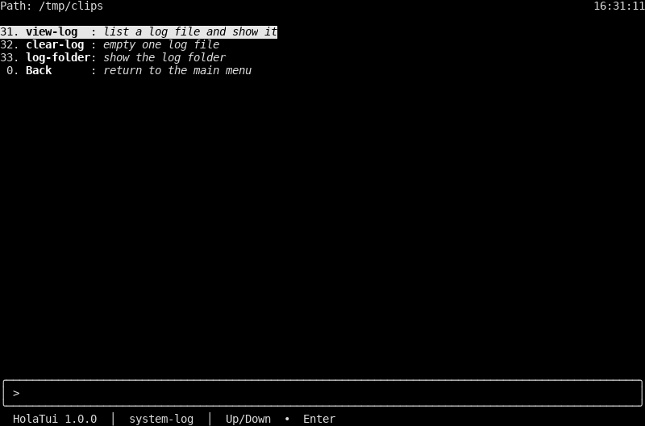

### `tui-about.png`

About page. The domain line is `Domain: Show a welcome message`.

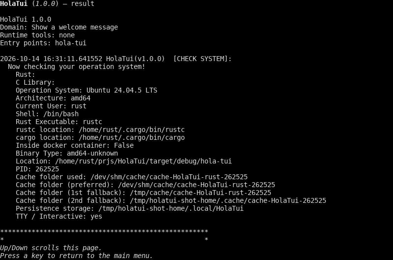
